<p align="center">
  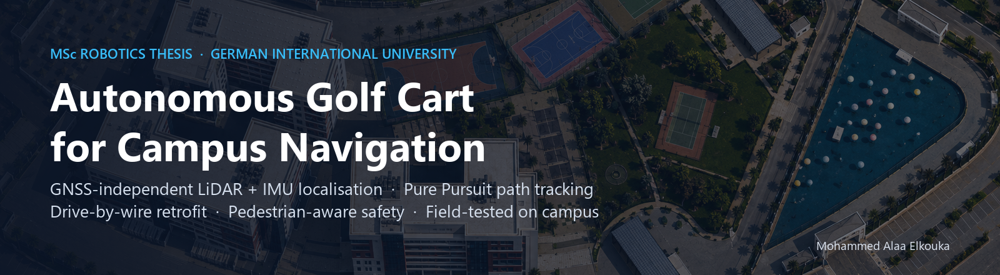
</p>

<p align="center">
  
  
  
  
  
</p>

# Autonomous Golf Cart for Campus Navigation

**A GNSS-independent autonomous driving system for an electric golf cart, developed and field-tested on the German International University (GIU) campus.**

MSc Robotics thesis project · Mohammed Alaa Elkouka · 2026

A standard, manually driven electric golf cart was converted into a self-driving vehicle. A
passenger picks a destination, and the cart finds its own position on a 3D LiDAR map of the
campus, plans a route, and drives there by itself. On the way it stops for pedestrians, goes
around obstacles, and never leaves a safe driving corridor. It does this **without GPS**.

---

## Demo video

<p align="center">
  <a href="docs/videos/demo.mp4">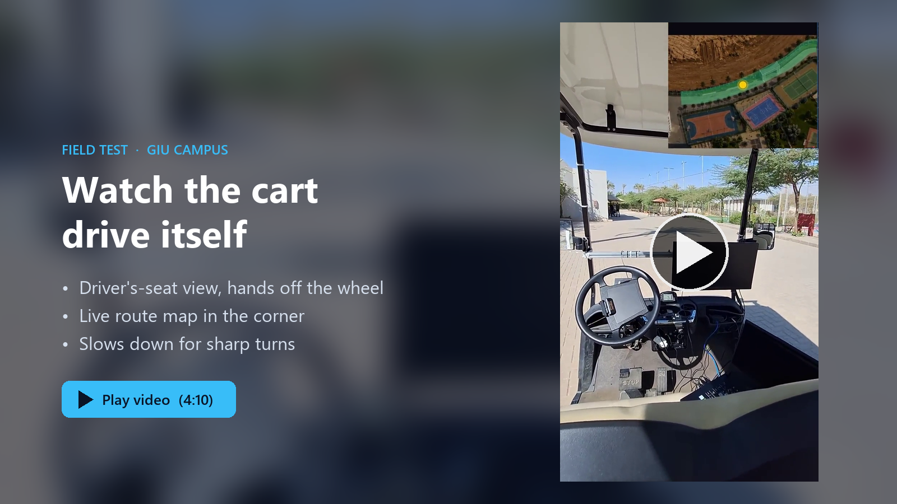</a>
</p>

<p align="center"><b><a href="docs/videos/demo.mp4">▶ Play the demo video (4:10)</a></b>: an autonomous campus run seen from the driver's seat.</p>

### Short demo (39 s)

<p align="center">
  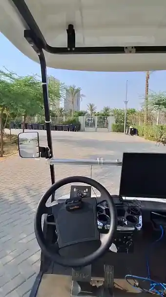
</p>

<p align="center">
  Silent preview, plays automatically.<br>
  <a href="docs/videos/demo_short.mp4">Download the short demo with sound (39 s, 7 MB)</a> ·
  <a href="docs/videos/demo.mp4">Download the full journey (4:10, 60 MB)</a>
</p>

---

## Key results

Measured on real campus runs, computed from the vehicle's 50 Hz control logs.

| Result | Value |
|---|---|
| Continuous autonomous run | **252.4 m** in 187.5 s (1.35 m/s average) |
| Mean path-tracking error (cross-track) | **0.106 m** (max 0.572 m, safety limit 1.9 m) |
| Stopping distance from destination | 0.78 m |
| Localisation quality (scan-match RMSE) | **0.050 m** mean, 0.990 mean inlier ratio |
| Campus field runs | **15 runs to 3 destinations: all reached the goal, none left the corridor** |
| Control loop rate | 50 Hz, held throughout every run |
| LiDAR-to-control pipeline delay | 23.1 ms mean |
| Dropped commands during the run | 0 |

---

## Contents

- [Demo video](#demo-video)
- [The system at a glance](#the-system-at-a-glance)
- [The challenge: driving without GPS](#the-challenge-driving-without-gps)
- [The vehicle](#the-vehicle)
- **Following one journey through the system**
  - [Before any journey: building the map](#before-any-journey-building-the-map)
  - [Step 1 · Where am I? (localisation)](#step-1--where-am-i-localisation)
  - [Step 2 · Where do I go? (path planning)](#step-2--where-do-i-go-path-planning)
  - [Step 3 · How do I steer? (path tracking)](#step-3--how-do-i-steer-path-tracking)
  - [Step 4 · Moving the wheels (low-level control)](#step-4--moving-the-wheels-low-level-control)
  - [Along the way: staying safe](#along-the-way-staying-safe)
- [How it all runs together](#how-it-all-runs-together)
- [Results](#results)
- [Key engineering findings](#key-engineering-findings)
- [Next step: a follower vehicle](#next-step-a-follower-vehicle)
- [Repository structure](#repository-structure) · [Build and run](#build-and-run)

---

## The system at a glance

Every autonomous vehicle answers the same questions in a loop: *what is around me, where am I,
where should I go, how do I steer, and how do I move?* Here each answer is one stage of the
pipeline, and an independent safety layer can override the vehicle at any moment. The loop
repeats until the goal is reached.

<p align="center">
  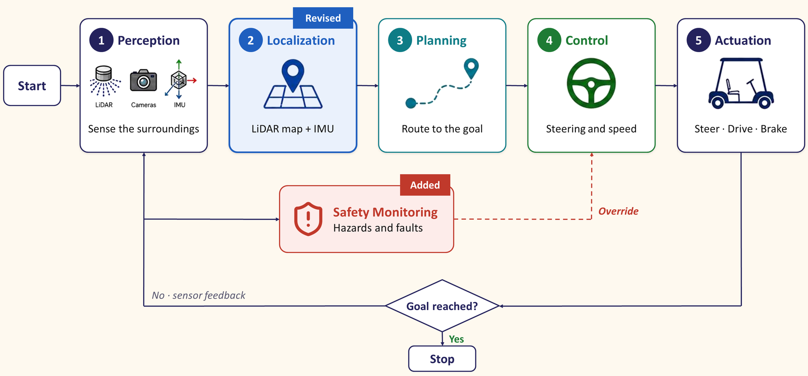
</p>

From a passenger's point of view a journey is simple: **find the cart → choose a destination →
ride**. The rest of this page follows that journey through the system, stage by stage.

<p align="center">
  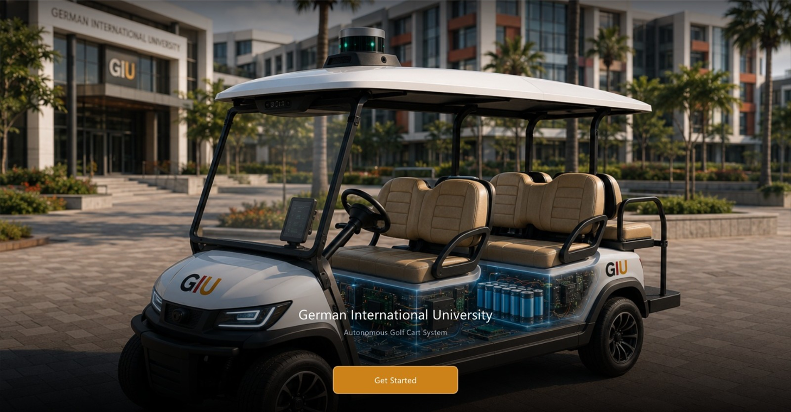
</p>

---

## The challenge: driving without GPS

The cart's route crosses four very different parts of the campus: the lab, a covered underground
corridor, a passage between buildings, and a "danger zone" next to glass façades.

| Route and the four operating conditions | What the cart sees there |
|---|---|
| 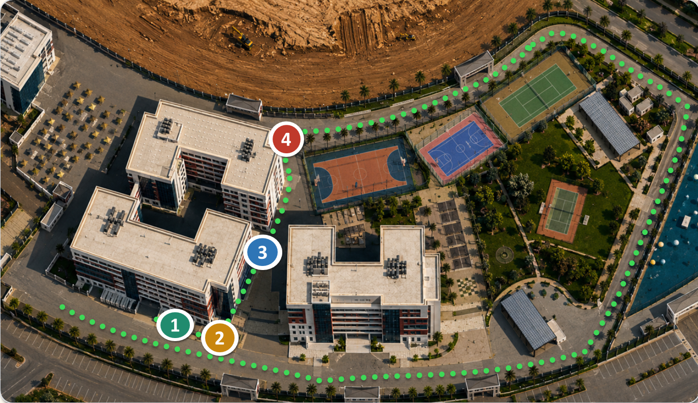 | 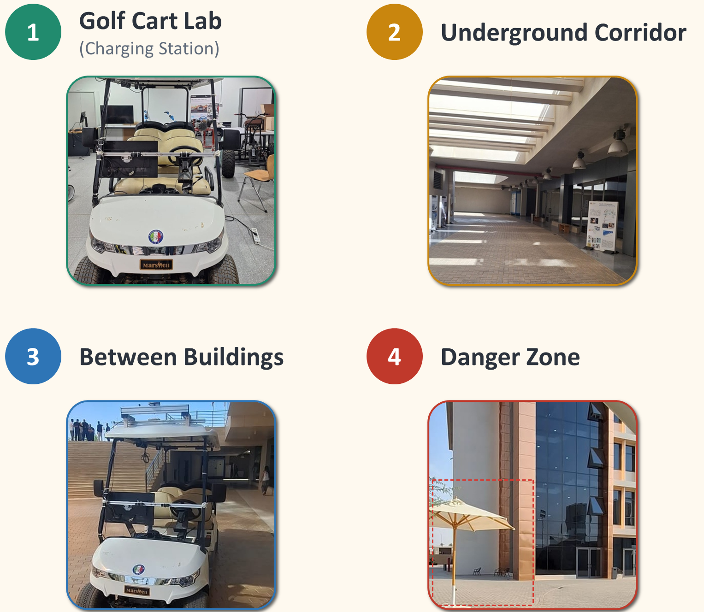 |

GPS was logged along the whole route. Wherever the sky is blocked, its error grows to **±11.5 m**,
several times wider than the corridor the cart must stay in.

<p align="center">
  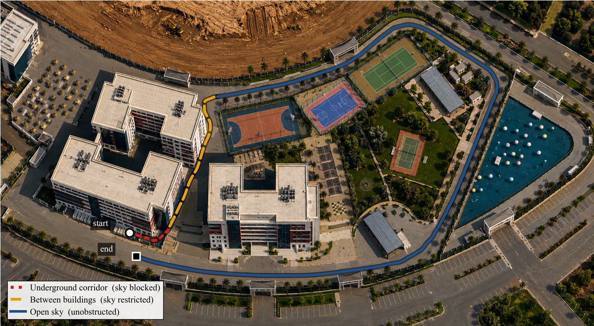
  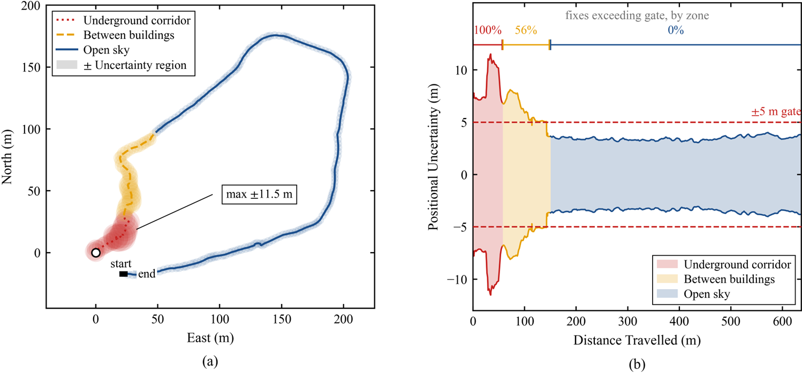
</p>

GPS alone cannot localise the vehicle here, so the final system does not use it at all.
Localisation relies on a **3D LiDAR matched against a map**, fused with an **inertial sensor (IMU)**.

---

## The vehicle

The golf cart was retrofitted with drive-by-wire control of steering, propulsion and braking,
while keeping manual driving possible at all times. The hardware has four layers: **sensors →
onboard computer → embedded controller → actuators**, all powered from the vehicle battery.

<p align="center">
  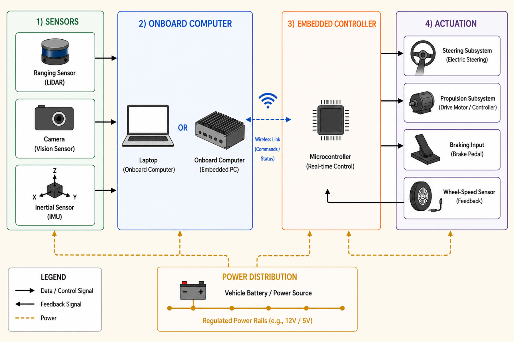
</p>

| Component | Details |
|---|---|
| LiDAR | Velodyne VLP-16 (16-beam 3D LiDAR), roof-mounted |
| IMU | Hiwonder IM10A, 100 Hz (accelerometer + gyroscope) |
| Cameras | USB cameras for pedestrian detection |
| Onboard computer | Laptop running the autonomy software |
| Embedded controller | ESP32 DevKit V1 on a custom PCB |
| Steering | NEMA stepper motor + CS-D508 driver, belt drive on the steering column (±23° wheel lock) |
| Propulsion | MCP4725 DAC → 0–5 V throttle signal to the motor controller, relay-switched forward/reverse |
| Braking | Relay-controlled brake actuation |
| Wheel speed | Hall-effect sensor |
| Link | Wi-Fi UDP between laptop and ESP32 |

Two custom PCBs were designed for the retrofit: a **control board** (ESP32, relay drivers, level
shifting) and a **power board** that turns the 48 V battery into switchable 24 V, 12 V and 5 V rails.

| Control PCB | Power PCB |
|---|---|
| 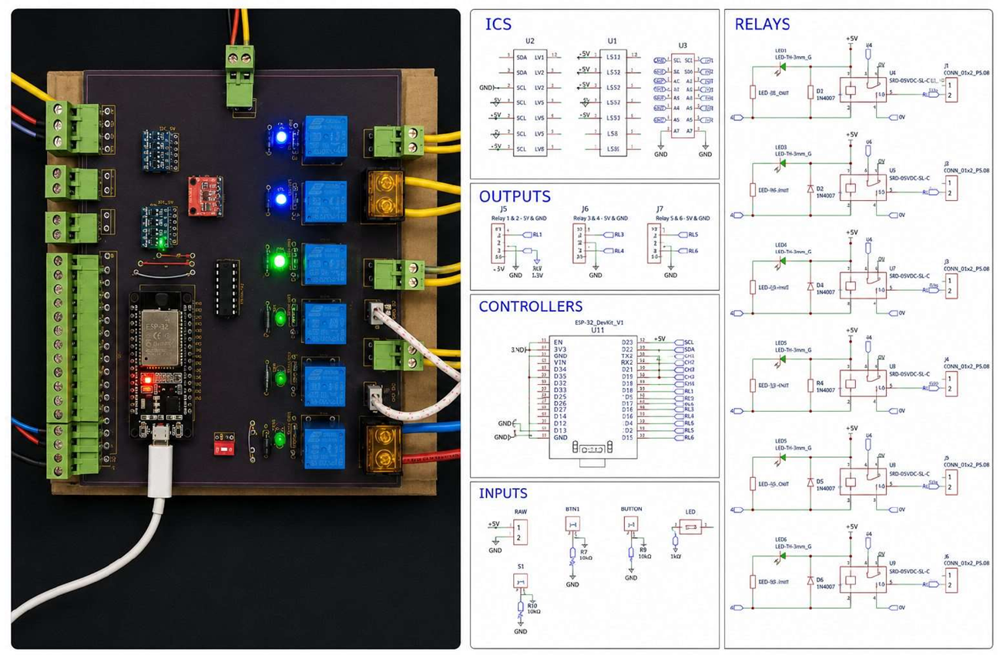 | 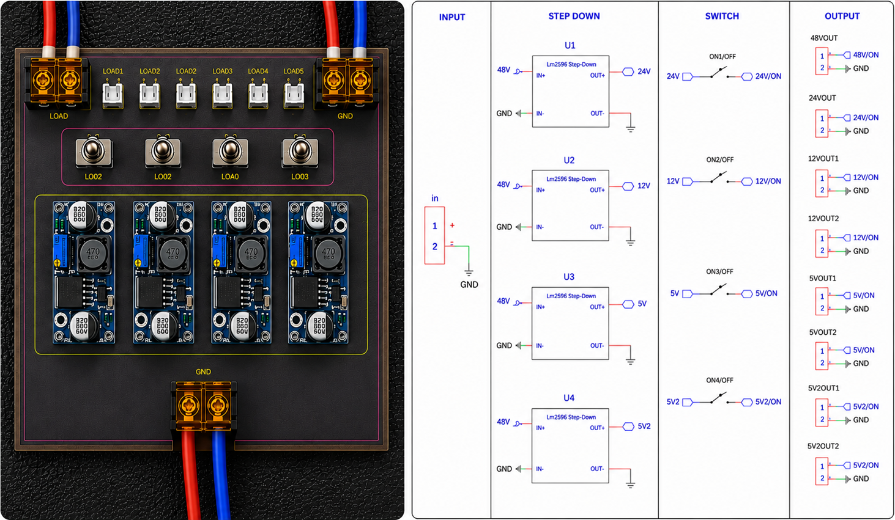 |

| The retrofitted cart | Steering actuator |
|---|---|
| 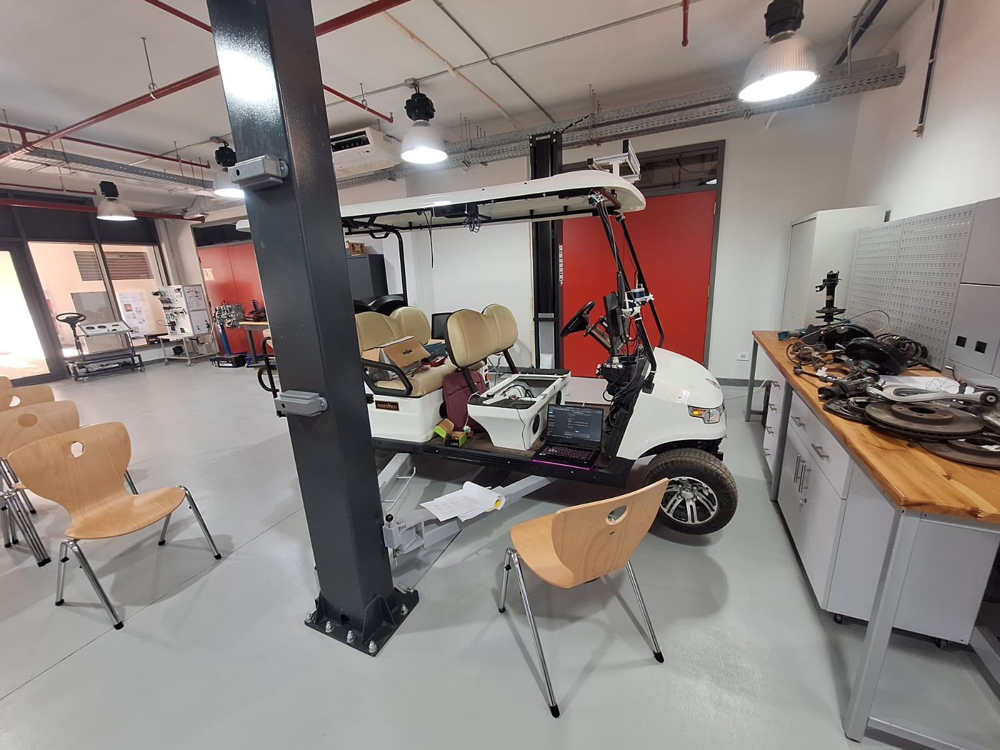 | 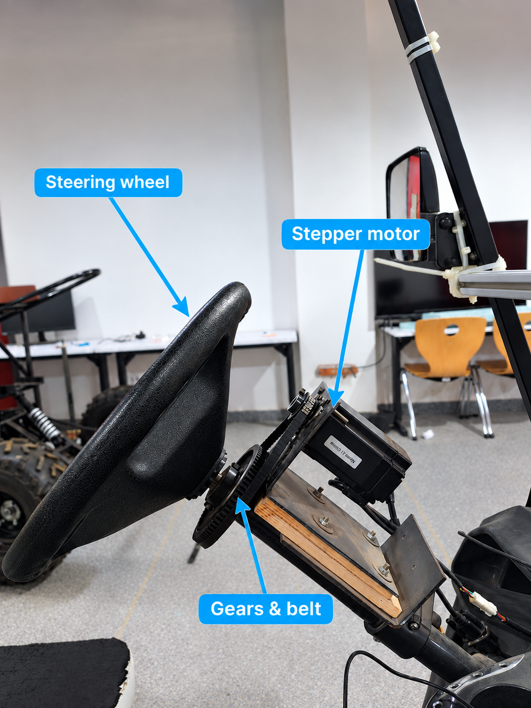 |

---

# Following one journey through the system

## Before any journey: building the map

The cart can only localise on a map it already knows. The campus was driven once with the
LiDAR recording, and the scans were assembled into a 3D point-cloud map (left). The trajectory of
that recording drive becomes the **reference path**, the road the cart will later follow (right).

<p align="center">
  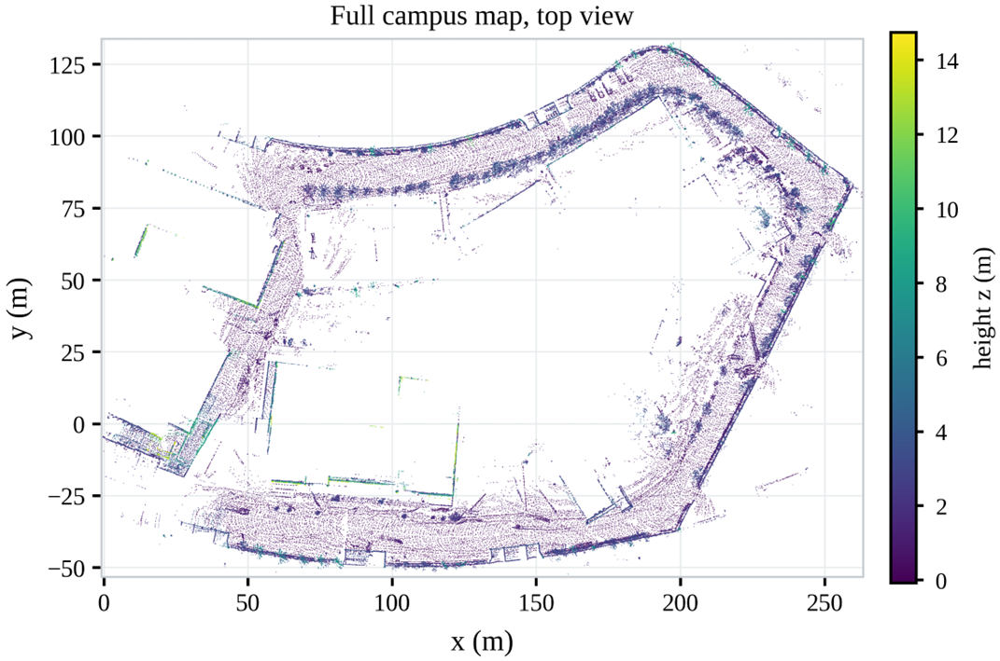
  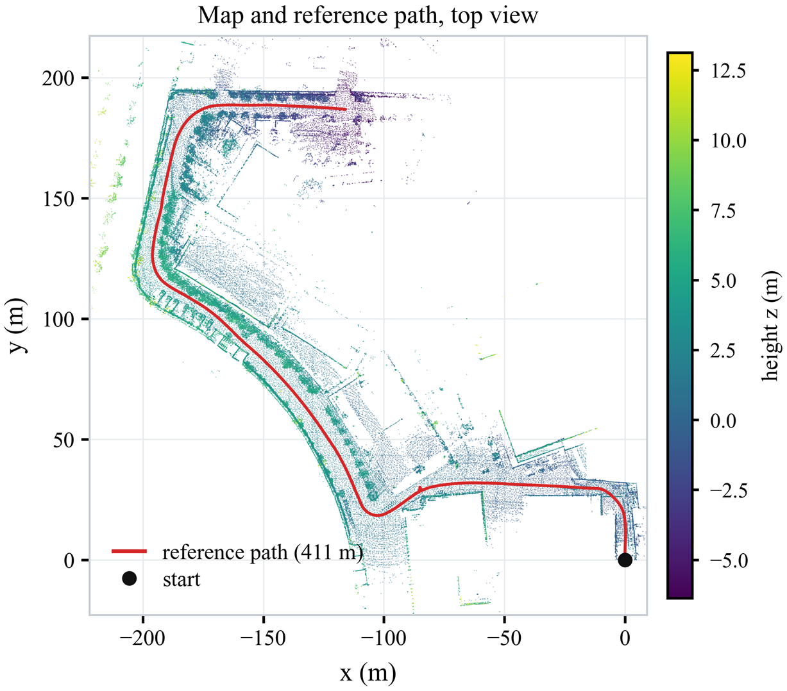
</p>

---

## Step 1 · Where am I? (localisation)

The journey starts with the cart finding itself on the map. The passenger presses **"Find My Cart"**:

<p align="center">
  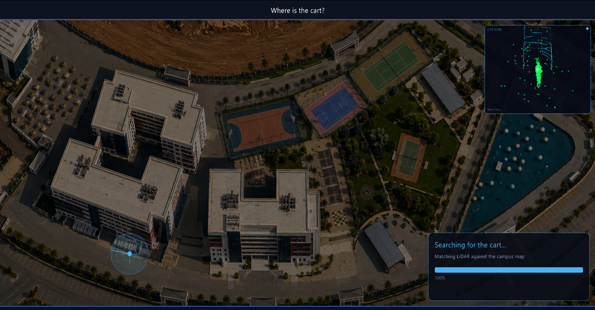
</p>

**1a. Global relocalisation (once, at start-up).** A particle filter spreads many guesses
("particles") over the map. Each guess is scored by how well the live LiDAR scan fits the map at
that position. Good guesses survive, poor ones are discarded, and the cloud shrinks onto the cart's
true position and heading. No manual placement is needed.

<p align="center">
  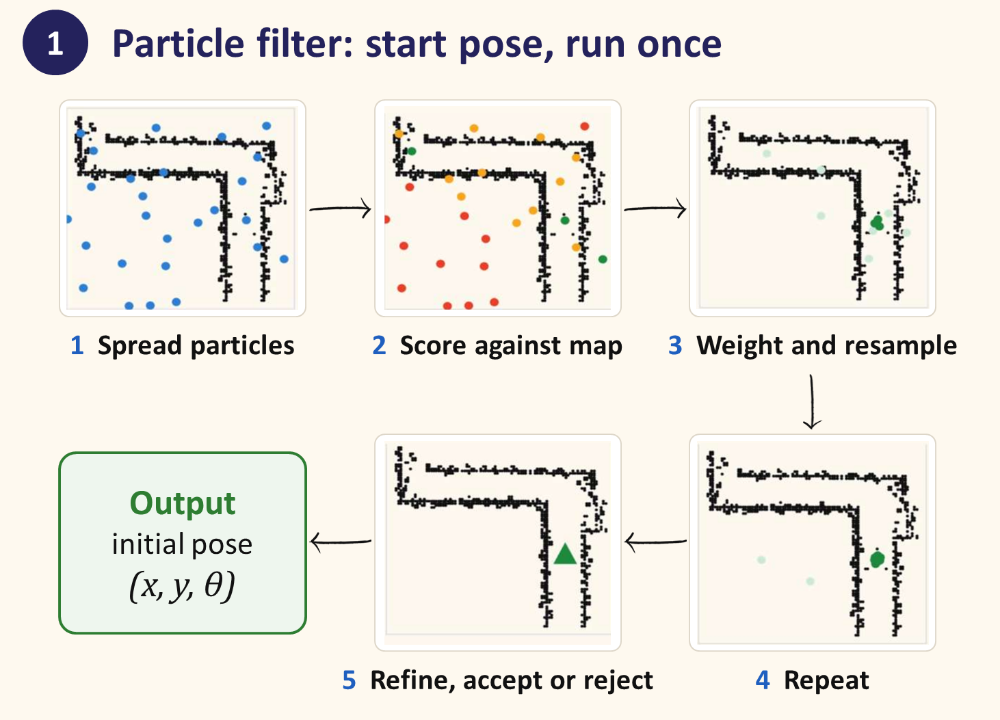
</p>

**1b. Continuous tracking (while driving).** From then on, an Extended Kalman Filter (EKF) keeps
the pose up to date. The IMU **predicts** the motion 100 times a second. Every new LiDAR scan is
**matched** against the map 20 times a second, and the difference **corrects** the prediction.

<p align="center">
  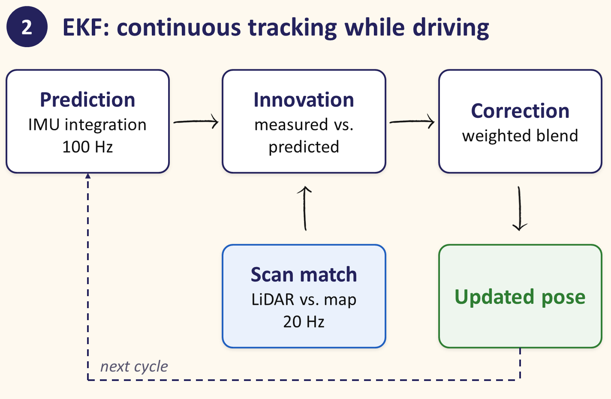
</p>

Two design rules came directly out of field testing:

- **Position from the LiDAR, heading from the IMU while driving.** Near glass and skylights the
  scan-matched heading drifted slowly and destabilised the steering (see
  [findings](#key-engineering-findings)), so while moving the controller uses the inertial heading.
- **Trust each correction only as much as the scan deserves.** Every map correction is weighted
  by scan-match quality. Poor matches are attenuated or rejected, and the cart rides on the IMU
  through difficult areas.

---

## Step 2 · Where do I go? (path planning)

Once located, the passenger picks a destination on the campus map:

<p align="center">
  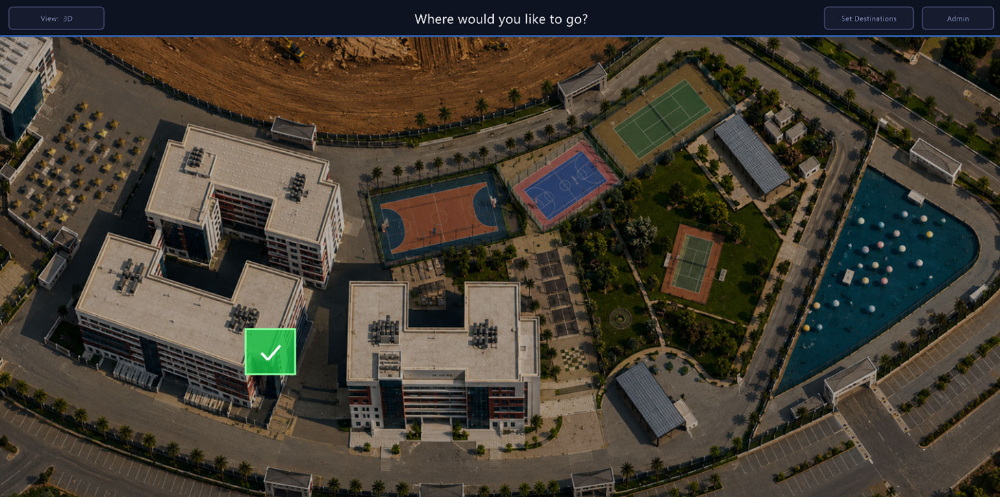
</p>

The planner then builds the route:

1. **Follow real roads.** Routes are taken from the recorded reference path and smoothed, so the
   cart only drives where a vehicle has already driven.
2. **Connect the cart to the route.** A short, smooth connection joins the cart's current position
   and heading to the path, rebuilt at every start.
3. **Wrap it in a corridor.** Every route gets a ±1.9 m driving corridor. The cart must stay inside
   it, and the safety watchdog enforces it.
4. **Handle difficult areas.** The campus is split into zones with their own routes and
   destinations. For the hardest stretch, the cart automatically switches to a detailed local
   "danger-zone" map, relocalises, and switches back afterwards.

---

## Step 3 · How do I steer? (path tracking)

The passenger presses **Begin Journey**, and the cart starts following the route. The controller
is **Pure Pursuit**, running at a fixed **50 Hz**: it picks a target point on the path ahead of the
cart, fits an arc from the cart to that point, and converts the arc into a steering angle.

<p align="center">
  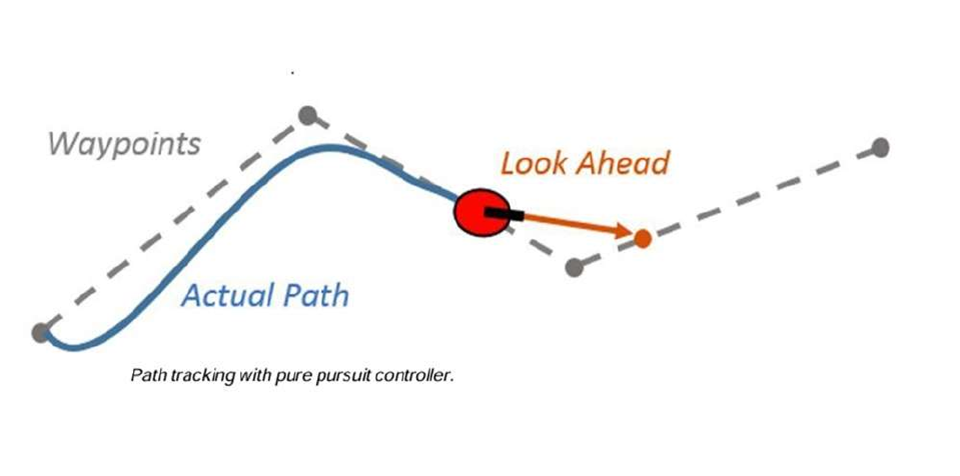
</p>

- The look-ahead distance adapts between **2.5 and 4.0 m**: longer at speed, shorter on curves.
- The pose is **predicted forward** to make up for the age of the LiDAR scan and the delay of the
  steering actuator, so the cart steers for where it *is*, not where it *was*.

Each steering command then goes through four stages before it reaches the wheel:

<p align="center">
  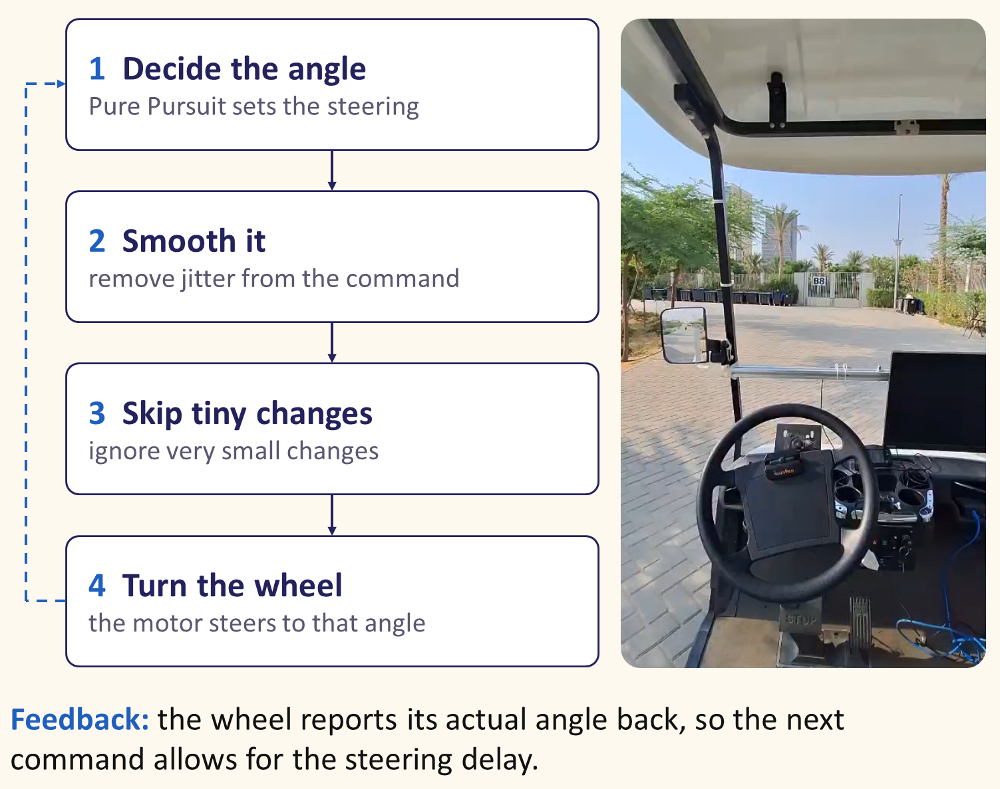
</p>

1. **Decide the angle:** Pure Pursuit sets the steering.
2. **Smooth it:** exponential smoothing removes jitter from the command.
3. **Skip tiny changes:** a new command is sent only when it changes by at least 1°.
4. **Turn the wheel:** the steering motor moves to that angle and reports it back, so the next
   command accounts for the steering delay.

During the drive the passenger sees the cart moving along its route:

<p align="center">
  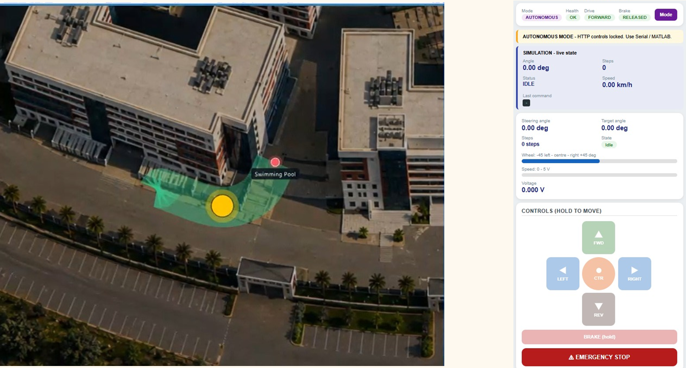
</p>

---

## Step 4 · Moving the wheels (low-level control)

Commands travel over Wi-Fi to the **ESP32** on the cart, which drives the actuators and protects the
hardware. Its main loop is **non-blocking**: steering, drive and safety functions each advance a
little on every pass, so no command ever waits for another to finish.

<p align="center">
  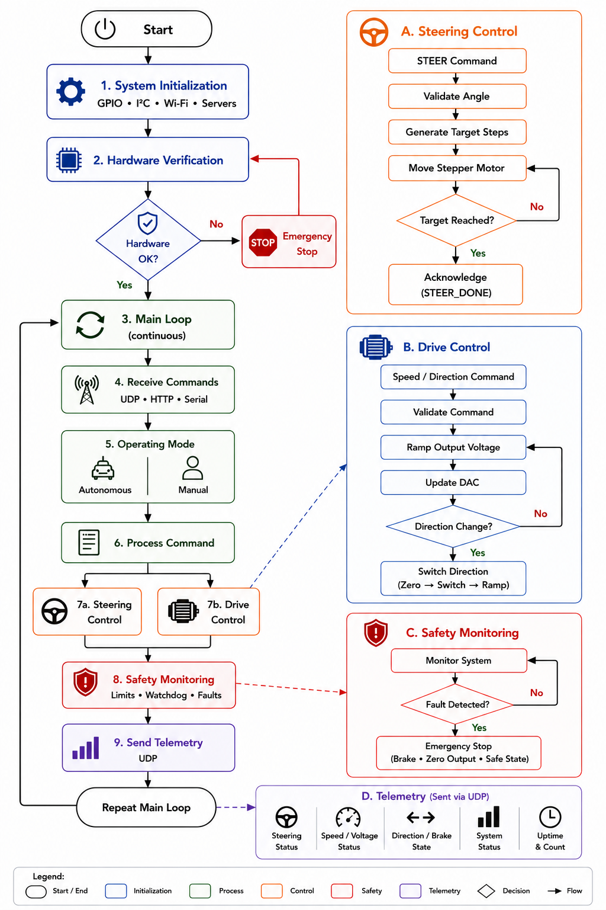
</p>

- **Steering control:** validates the angle, converts it to stepper steps, drives the motor, and
  confirms with `STEER_DONE`.
- **Drive control:** ramps the throttle voltage smoothly, with a safe *zero → switch → ramp*
  sequence when changing direction.
- **Safety monitoring:** a DAC heartbeat and a communication watchdog. If no command arrives for 2 s,
  the cart stops.
- **Telemetry:** steering state, speed, voltage and status are streamed back to the laptop.
- **Manual mode:** a phone web interface can drive the cart manually.

The laptop timestamps every command and measures the round trip from the ESP32's reply. That
measured delay is fed back into the path-tracking step above.

<p align="center">
  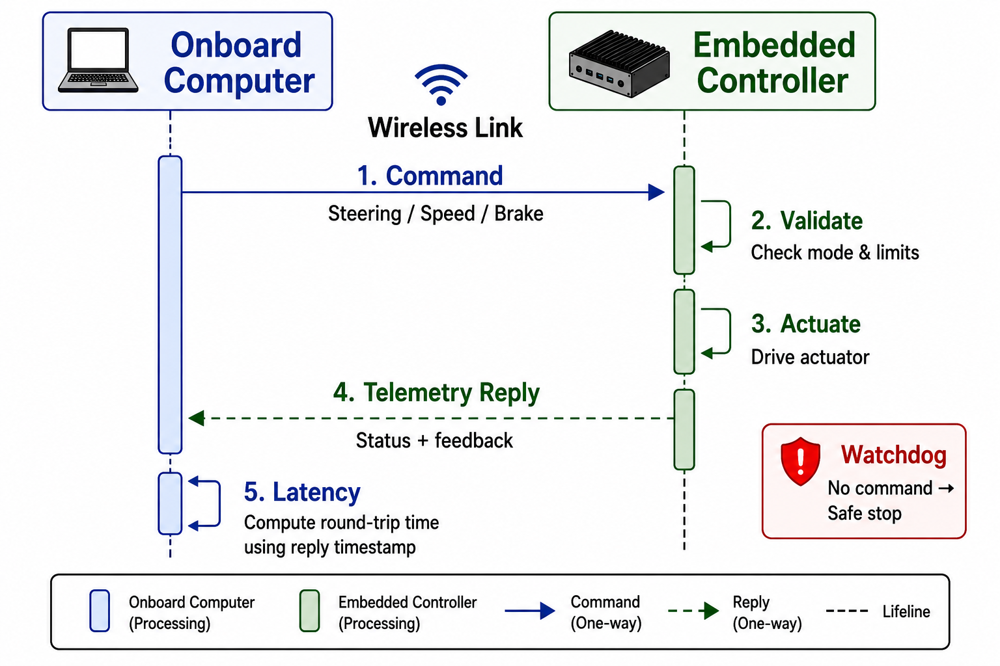
</p>

---

## Along the way: staying safe

While the cart drives, two independent checks watch the path ahead.

| Pedestrians: stop and wait | Static obstacles: re-plan around them |
|---|---|
| 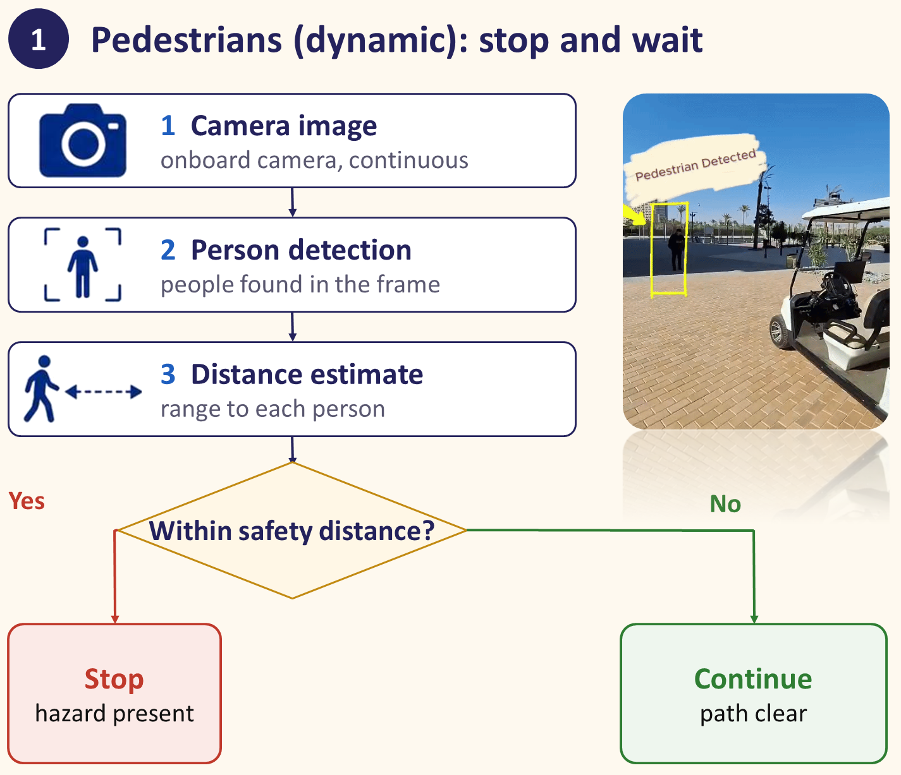 | 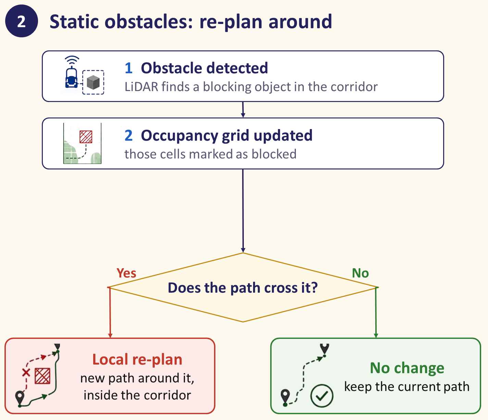 |

- **Pedestrians** are detected by a camera running a YOLOv8 person detector. If someone is within
  the safety distance, the cart stops and waits. Once the person has cleared, the drive is resumed
  with a Resume button, so the cart never restarts on its own.
- **Static obstacles** are marked as blocked cells in an occupancy grid. If the route crosses them,
  a new local path is planned around the obstacle, still inside the corridor.

These sit on top of further safety layers that can stop the cart at any time:

| Layer | Behaviour |
|---|---|
| Corridor watchdog | Emergency stop if the cart moves more than 1.9 m sideways from its path |
| Localisation monitor | Stops if localisation quality is lost for too long |
| ESP32 watchdog | Stops the cart if commands stop arriving (e.g. Wi-Fi loss) |
| Manual override | The driver can take control at any time |

---

## How it all runs together

All of the steps above run **at the same time** as separate threads, each at its own rate. They
never call each other directly: they only read from and write to one shared **vehicle state**.
A slow task (for example rendering the map) can therefore never delay the 50 Hz control loop.

<p align="center">
  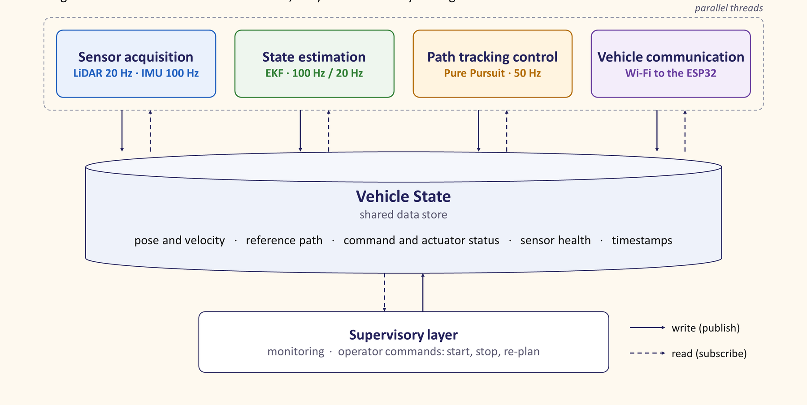
</p>

| Module | File | Role |
|---|---|---|
| Main / GUI loop | `main.cpp` | Starts all threads, runs the 60 FPS interface |
| Localisation | `localization.cpp` | LiDAR driver, IMU driver, scan matcher, EKF fusion, relocalisation |
| Planning | `planning.cpp` | Route building, smoothing, corridor generation |
| Control | `control.cpp` | Pure Pursuit path tracking at 50 Hz, safety watchdog |
| Communication | `communication.cpp` | UDP link to the ESP32, telemetry, CSV data logger |
| User interface | `ui.cpp` | Map views, passenger panels, live telemetry |
| Shared definitions | `common.hpp` | Shared types, globals and all tuning constants |
| EKF core | `codegen/` | Extended Kalman Filter generated from MATLAB |
| Firmware | `golf_cart_v28_smooth/` | ESP32 low-level controller |
| Pedestrian detection | `tools/pedestrian_detect.py` | Separate camera process (YOLOv8) |

---

## Results

### A continuous 252 m campus run

<p align="center">
  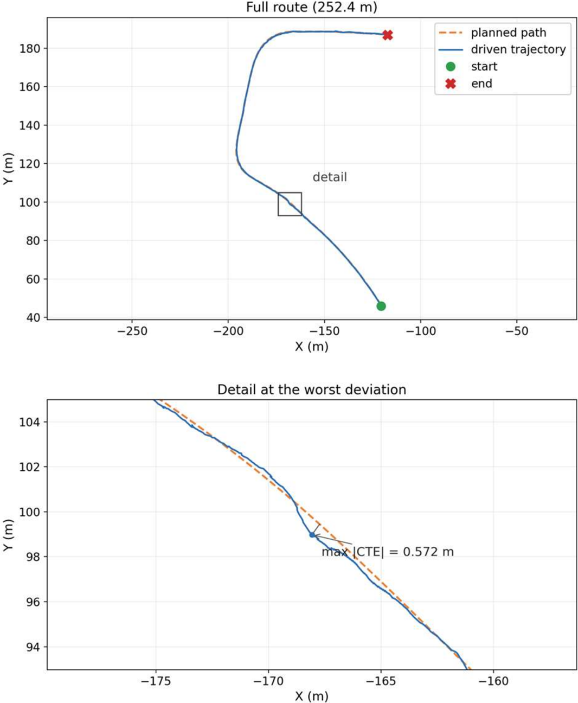
</p>

At route scale the driven trajectory and the planned path are indistinguishable. The magnified
view at the bottom shows the worst moment of the run: a **0.572 m** deviation, well inside the
1.9 m corridor. The mean deviation over the whole run was **0.106 m**.

| Metric | Value |
|---|---|
| Distance driven / duration | 252.4 m / 187.5 s |
| Average speed | 1.35 m/s |
| Mean / maximum cross-track error | 0.106 m / 0.572 m |
| Final distance to destination | 0.78 m |
| Mean scan-match RMSE / inlier ratio | 0.050 m / 0.990 |
| Steering commands sent | 328 |

<p align="center">
  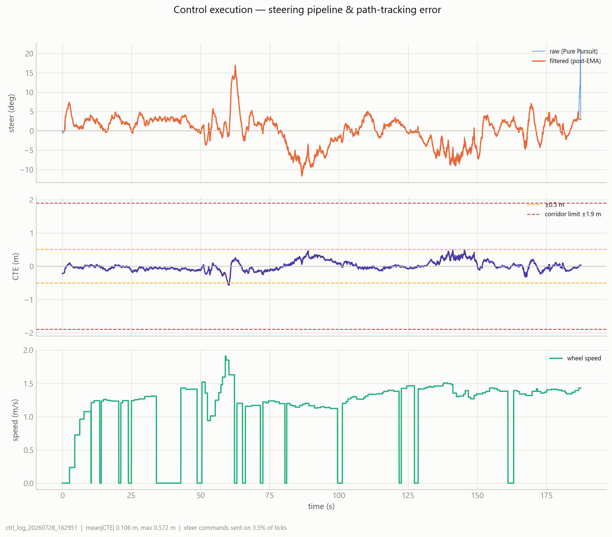
</p>

Steering, cross-track error against the 1.9 m corridor limit, and wheel speed over the run. The
error stays bounded around zero and does not grow over time, which shows stable tracking.

<p align="center">
  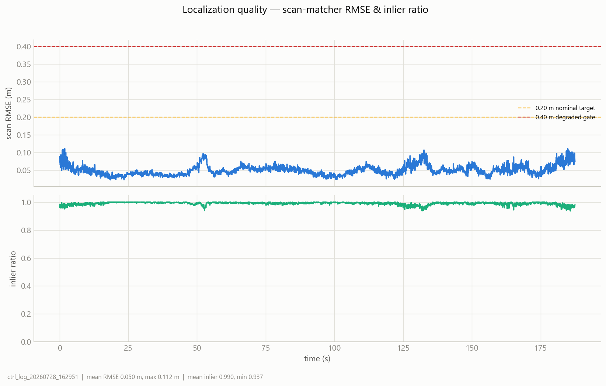
</p>

Localisation quality stayed far below the degraded-quality (0.25 m) and rejection (0.40 m)
thresholds for the entire run.

### Repeated runs to three destinations

| Group | Runs | Distance | Mean cross-track error | Reached goal |
|---|---|---|---|---|
| Reported run | 1 | 252 m | 0.106 m | 1 of 1 |
| Destination 1 (repeats) | 6 | 272–283 m | 0.120–0.407 m | 6 of 6 |
| Destination 2 | 6 | 195–209 m | 0.109–0.390 m | 6 of 6 |
| Destination 3 | 2 | 277–285 m | 0.175–0.225 m | 2 of 2 |

**All 15 runs reached the goal, and no run left the 1.9 m safety corridor.** Tracking accuracy
varies between runs mainly with the cart's starting position and heading.

### Localisation in the laboratory

| Test | Result |
|---|---|
| Stationary, 60 s runs | 0.052 m mean RMSE, 0.965 inlier ratio, ≤ 2.1 cm position drift |
| Short autonomous lab run | 0.030 m RMSE, cross-track error within 2.85 cm |

---

## Key engineering findings

**1. A localiser can be "accurate" and still break the controller.**
The first eight campus runs all failed, even though localisation looked accurate. The logs showed
the scan-matched heading drifting by about 1° per second near glass and skylights: too slow to
trigger any quality alarm, but enough to make the controller steer against a heading the cart did
not have. Taking heading from the IMU during motion, and weighting map corrections by match
quality, fixed it. After the fix, every campus run reached its destination.

**2. Blocking command execution causes oscillation.**
Early firmware finished each steering move before accepting the next command. On the real cart this
produced a steering oscillation through corners. The non-blocking firmware lets new commands
interrupt old ones, which removed the oscillation.

<p align="center">
  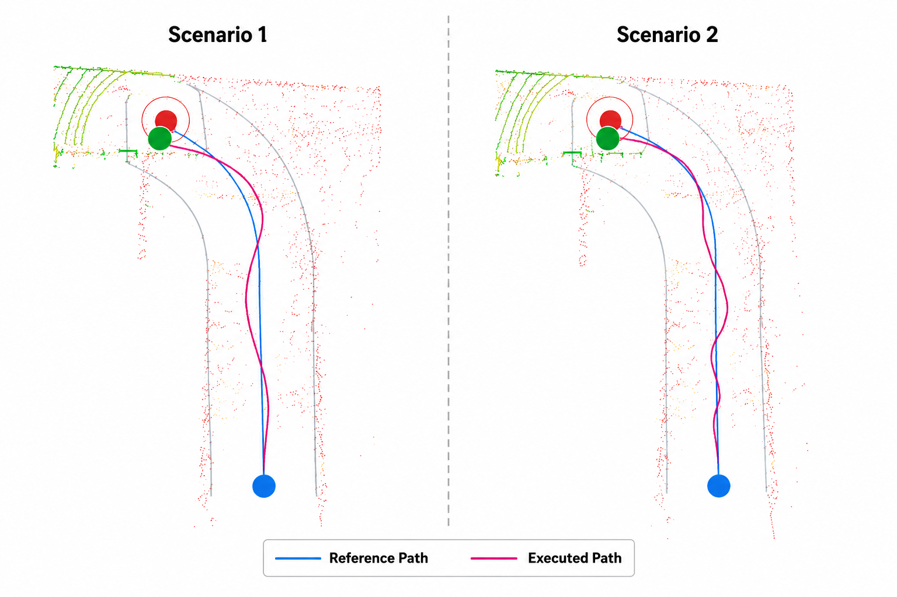
</p>

**3. Fewer, larger steering commands are more stable.**
The 1° send gate is a stability measure, not just a bandwidth saving. It stopped the controller
chasing sensor noise with constant micro-corrections.

---

## Next step: a follower vehicle

The platform is designed to grow into multi-vehicle operation: a BLDC-driven mobile robot following
the golf cart as a "virtual trailer". The follower's drive motors have been characterised on the
bench. The main limitation found is the low resolution of their built-in Hall sensors, which
motivates adding encoders.

<p align="center">
  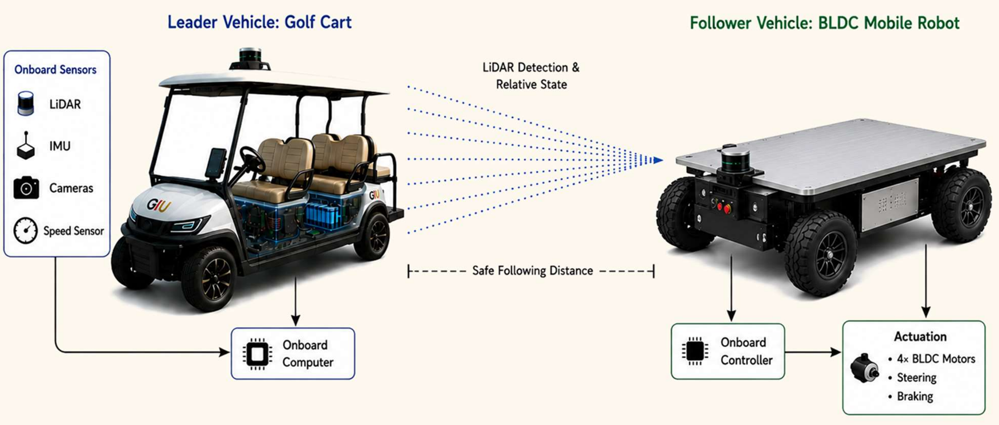
</p>

<p align="center">
  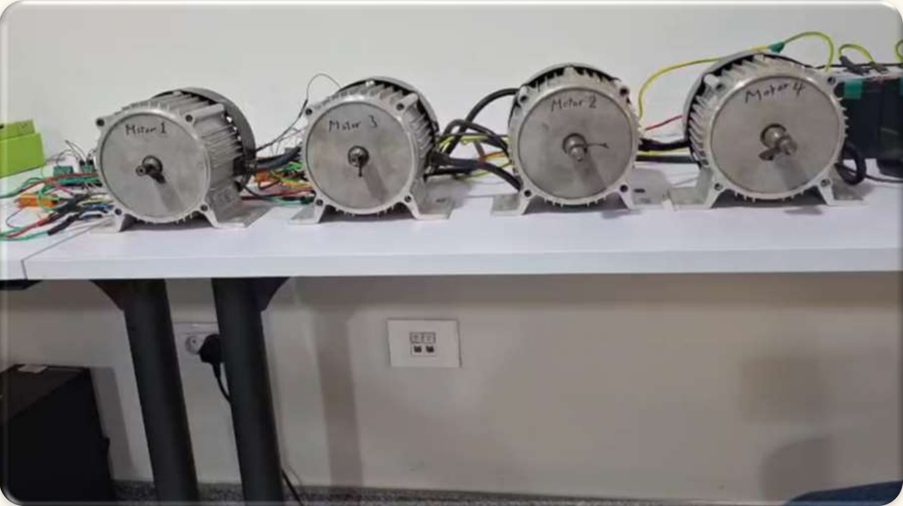
</p>

---

## Repository structure

```
├── main.cpp, localization.cpp, planning.cpp,
│   control.cpp, communication.cpp, ui.cpp      Autonomy stack (C/C++)
├── common.hpp                                  Shared types and tuning constants
├── steer_test.cpp, loc_test.cpp                Steering and localisation test harnesses
├── codegen/                                    MATLAB-generated EKF code
├── golf_cart_v28_smooth/                       ESP32 firmware
├── runtime_data/                               Maps (.ply), routes, configuration, UI assets
├── tools/                                      Map building, pedestrian detection, log analysis, figures
├── matlab/                                     GPS/IMU simulation, offline LiDAR mapping and localisation
├── Fdirection map  top/, Rdirection top map/,
│   danger zone map files/                      Raw LiDAR-mapping exports the maps are built from
├── include/, raylib-5.0_win64_mingw-w64/       Third-party headers and the Raylib graphics library
├── docs/images/, docs/videos/                  Figures and the demo video used in this README
├── REQUIREMENTS.md                             Everything needed to install and run the system
└── CMakeLists.txt                              Build configuration
```

Each supporting folder has its own guide: [tools/README.md](tools/README.md) and
[matlab/README.md](matlab/README.md).

## Build and run

See **[REQUIREMENTS.md](REQUIREMENTS.md)** for all dependencies and hardware setup.

```
cmake -B build -G "MinGW Makefiles"
cmake --build build
cd runtime_data
GolfCartControl.exe
```

---

## Author

**Mohammed Alaa Elkouka**
MSc Robotics, German International University (GIU) · BSc Mechatronics, Mansoura University

[LinkedIn](https://www.linkedin.com/in/muhammed-elkouka-692b11220)

---

© 2026 Mohammed Alaa Elkouka. All rights reserved. No part of this repository (code, maps,
figures or data) may be copied, reused or redistributed without the author's written permission.
