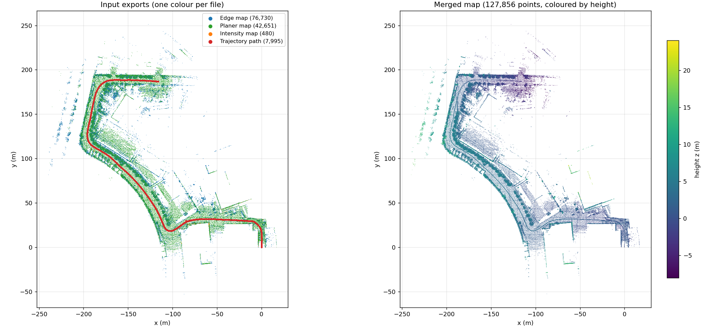

# Map merge

Builds the localisation map the cart uses from the files exported by the LiDAR mapping software.

One mapping recording is exported as four PLY files:

| File | Contents |
|---|---|
| `Edge map.ply` | Edge features (walls, corners, poles) |
| `Planer map.ply` | Planar surfaces (ground, façades) |
| `Intensity map.ply` | High-intensity returns (signs, reflective markings) |
| `Trajectory path.ply` | The path the vehicle drove while recording |

`merge_ply_maps.py` combines them into one PLY in the format `localization.cpp` loads: binary,
float x/y/z only, with the empty `face` element of the exports removed.

## Demo: rebuild the forward campus map

The four forward-map exports are included in `forward_map_exports/`. From this folder, run:

```
python merge_ply_maps.py output/Campus_TopLidar_Forward_merged.ply ^
    "forward_map_exports/Edge map.ply" "forward_map_exports/Planer map.ply" ^
    "forward_map_exports/Intensity map.ply" "forward_map_exports/Trajectory path.ply" ^
    --preview output/merged_map_preview.png ^
    --compare ../../runtime_data/Campus_TopLidar_Forward.ply
```

Output:

```
    76,730 pts  forward_map_exports/Edge map.ply
    42,651 pts  forward_map_exports/Planer map.ply
       480 pts  forward_map_exports/Intensity map.ply
     7,995 pts  forward_map_exports/Trajectory path.ply
wrote 127,856 points -> output/Campus_TopLidar_Forward_merged.ply
preview   -> output/merged_map_preview.png
compare   -> IDENTICAL to ../../runtime_data/Campus_TopLidar_Forward.ply
```

The rebuilt map is byte-for-byte identical to the map the cart drives on.



*Left: each exported file in its own colour, with the recorded trajectory in red. Right: the
merged map, coloured by height.*

## Options

| Option | Effect |
|---|---|
| `--zmin Z`, `--zmax Z` | Drop points below / above a height (m), e.g. to remove ceilings |
| `--preview IMAGE.png` | Save the picture above |
| `--compare MAP.ply` | Report whether the result is byte-identical to an existing map |

The exact commands for all three maps in `runtime_data/` (forward, reverse, danger zone) are in
the header of `merge_ply_maps.py`.

Requires Python 3 with `numpy` (and `matplotlib` for `--preview`).
